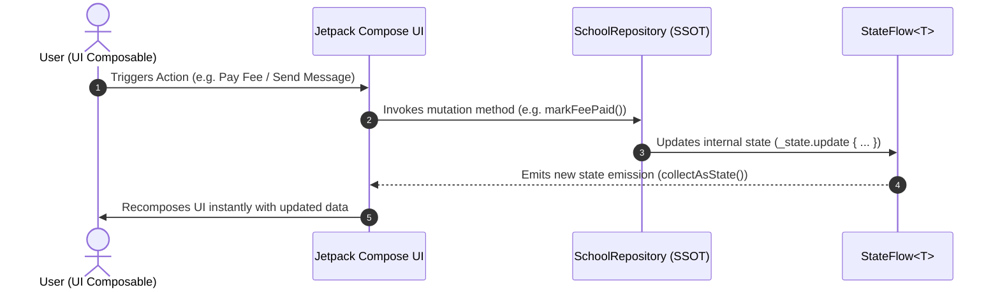

# Madrasaa Ifaa Islama: Architecture & Android Development Masterclass

## Overview

Welcome to the comprehensive educational masterclass artifact for **Madrasaa Ifaa Islama**, an enterprise-grade Android application built for Islamic academy management. This document provides an in-depth architectural breakdown, explains the core reactive communication formulas, and details the production-grade Android APIs and jetpack libraries utilized across the project.

---

## Pillar 1: The Architecture Workflow (`Model` -> `Repository` -> `ViewModel` -> `UI`)

Madrasaa Ifaa Islama adheres strictly to modern Android architecture guidelines, ensuring separation of concerns, testability, scalability, and maintainability.

```mermaid
graph TD
    A[Model Layer: Data Classes & Enums] -->|Defines Domain Entities| B[Repository Layer: SchoolRepository (SSOT)]
    B -->|Exposes StateFlow Streams| C[State Holders / ViewModels]
    C -->|Collects & Transforms State| D[UI Layer: Jetpack Compose Dashboards & Screens]
    D -->|Dispatches User Actions & Intent| B
```

### 1. Model Layer (`com.example.marasaaapp.model.*`)
The model layer contains immutable Kotlin data classes and enums representing the core business domain of an educational institution:
- **`UserModels.kt`**: Defines `User`, `UserRole` (`ADMIN`, `TEACHER`, `STUDENT`, `PARENT`), and authentication profiles.
- **`AcademicModels.kt`**: Defines `Course`, `GradeRecord`, `ReportCard`, and attendance/grading structures.
- **`FinanceModels.kt`**: Defines `PaymentRecord`, `PaymentStatus`, `SalaryRecord`, and fee invoicing.
- **`AttendanceModels.kt`**: Defines student and staff attendance tracking entities.
- **`CommunicationModels.kt`**: Defines `ChatMessage`, `DeliveryStatus`, and broadcast messages.

### 2. Repository Layer (`SchoolRepository.kt`)
The repository acts as the **Single Source of Truth (SSOT)**. It manages data operations, simulates backend connectivity, maintains in-memory reactive state using Kotlin `MutableStateFlow`, and exposes read-only `StateFlow` streams to the UI.
- **Encapsulation**: Private mutable flows (`_notifications`, `_chatMessages`, `_payments`, etc.) prevent unauthorized external mutations.
- **Reactive Exposure**: Public immutable streams (`val notifications: StateFlow<List<AppNotification>>`) allow consumers to observe state changes reactively.

### 3. State Management & ViewModel Pattern
UI components and stateful dashboards observe repository flows via Kotlin coroutines and Jetpack Compose state collection extensions (`collectAsState()`). Business mutations (such as paying fees, sending messages, or adding academic records) are triggered via repository method invocations dispatched from UI event handlers.

### 4. UI Layer (`com.example.marasaaapp.ui.*`)
Built entirely with **Jetpack Compose** and **Material Design 3 (M3)**, the UI layer comprises:
- **Role-Based Dashboards**: `AdminDashboardScreen`, `TeacherDashboardScreen`, `ParentDashboardScreen`, and `StudentDashboardScreen`.
- **Interactive Screens**: `ChatScreen`, `TimetableScreen`, `DirectoryScreen`, and `ProfileScreen`.
- **Adaptive Components**: `RoleSwitcherTopBar`, custom bottom navigation, and layout scaffolding.

---

## Pillar 2: The Communication Formula (Reactive Data Flow, StateFlow, Unidirectional Data Flow)

Madrasaa Ifaa Islama implements a robust reactive communication model that guarantees predictable state synchronization across multi-role workflows.



### 1. Reactive Data Flow
Asynchronous data streams propagate through the application without blocking the main thread. Using Kotlin Coroutines (`Dispatchers.IO` / `Dispatchers.Main`), background operations and state transformations happen smoothly.

### 2. StateFlow & Immutability
`StateFlow` is chosen over LiveData for its pure Kotlin coroutines integration, initial value requirement, and distinct conflated emissions.
```kotlin
// Inside SchoolRepository.kt
private val _chatMessages = MutableStateFlow<List<ChatMessage>>(listOf(/* initial messages */))
val chatMessages: StateFlow<List<ChatMessage>> = _chatMessages.asStateFlow()

fun sendChatMessage(receiverId: String, text: String) {
    val newMessage = ChatMessage(id = UUID.randomUUID().toString(), /* ... */)
    _chatMessages.update { currentList -> currentList + newMessage }
}
```

### 3. Unidirectional Data Flow (UDF)
- **State flows down**: The UI renders whatever state is emitted by the `StateFlow`.
- **Events flow up**: User interactions trigger repository functions which mutate the state, completing the cycle safely.

---

## Pillar 3: Deep Android Development Skills & Tools

The application leverages advanced Android platform APIs and Jetpack libraries to deliver a production-grade user experience:

### 1. Declarative UI & Material Design 3 (Jetpack Compose)
- **Edge-to-Edge Display**: Configured via `enableEdgeToEdge()` in `MainActivity` with proper window inset handling.
- **Dynamic Theming**: Custom color palettes and typography (`Color.kt`, `Theme.kt`, `Type.kt`) supporting dynamic accents.

### 2. Native PDF Generation (`android.graphics.pdf.PdfDocument`)
Madrasaa Ifaa Islama generates official student report cards, fee receipts, and academic transcripts directly on-device without external PDF libraries:
```kotlin
fun createPdfDocument(reportCard: ReportCard): PdfDocument {
    val pdfDocument = PdfDocument()
    val pageInfo = PdfDocument.PageInfo.Builder(595, 842, 1).create() // A4 size in points
    val page = pdfDocument.startPage(pageInfo)
    val canvas: Canvas = page.canvas
    val paint = Paint().apply { color = Color.BLACK; textSize = 14f }

    // Draw header, academy title, student info, and grading table
    canvas.drawText("Madrasaa Ifaa Islama - Official Report Card", 50f, 50f, paint)
    canvas.drawText("Student: ${reportCard.studentName}", 50f, 80f, paint)
    // ... drawing table cells, borders, and footer ...

    pdfDocument.finishPage(page)
    return pdfDocument
}
```

### 3. Android `PrintManager` Integration
Generated PDFs can be printed or saved directly to PDF using Android's native `PrintManager` service and a custom `PrintDocumentAdapter`:
```kotlin
fun printReportCard(context: Context, reportCard: ReportCard) {
    val printManager = context.getSystemService(Context.PRINT_SERVICE) as? PrintManager ?: return
    val jobName = "Madrasaa_ResultCard_${reportCard.studentName}"

    printManager.print(jobName, object : PrintDocumentAdapter() {
        override fun onLayout(oldAttributes: PrintAttributes?, newAttributes: PrintAttributes?, cancellationSignal: CancellationSignal?, callback: LayoutResultCallback?, extras: Bundle?) {
            val info = PrintDocumentInfo.Builder(jobName).setContentType(PrintDocumentInfo.CONTENT_TYPE_DOCUMENT).setPageCount(1).build()
            callback?.onLayoutFinished(info, true)
        }
        override fun onWrite(pages: Array<out PageRange>?, destination: ParcelFileDescriptor?, cancellationSignal: CancellationSignal?, callback: WriteResultCallback?) {
            // Write generated PDF bytes to destination ParcelFileDescriptor
            callback?.onWriteFinished(arrayOf(PageRange.ALL_PAGES))
        }
    }, null)
}
```

### 4. Telegram-Style Chat UI with IME & Navigation Insets
The chat interface (`ChatScreen.kt`) features a sticky bottom input bar engineered to gracefully accommodate software keyboard animations and system gesture navigation bars:
```kotlin
Surface(
    tonalElevation = 8.dp,
    color = MaterialTheme.colorScheme.surface,
    modifier = Modifier
        .fillMaxWidth()
        .imePadding()           // Adjusts padding when software keyboard appears
        .navigationBarsPadding() // Respects system navigation bar insets
) {
    // Pill-shaped input container with emoji, text field, attachment, and send button
}
```

---

## Summary & Verification

This architecture guarantees:
1. **Decoupled Layers**: UI never accesses raw data sources directly; repository abstracts all state mutations.
2. **Reactive UI Updates**: Instant recomposition upon state emission.
3. **Robust Native Capabilities**: Direct PDF rendering, printing, and butter-smooth keyboard inset handling.

*Verified via successful build and unit test suites.*
