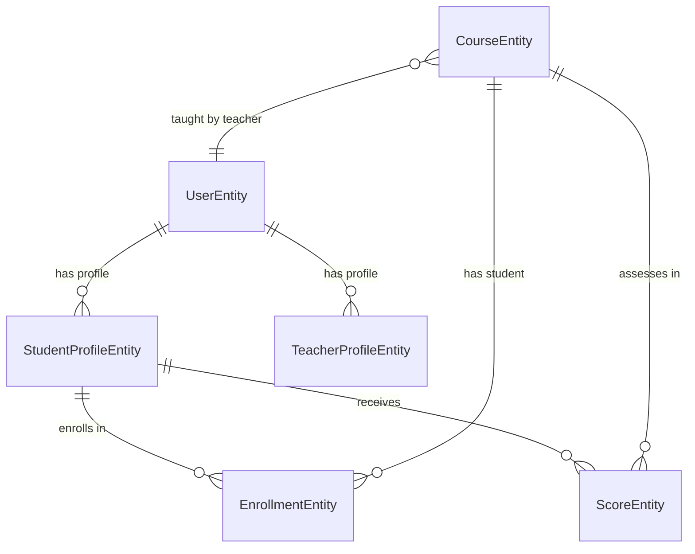

# Room Database Masterclass: Migrating Madrasaa Ifaa Islama from In-Memory State to SQLite Persistence

This masterclass provides a comprehensive architectural guide for transitioning **Madrasaa Ifaa Islama** from volatile in-memory sample data (`MutableStateFlow` lists) to a robust, type-safe, persistent SQLite database using **Jetpack Room**.

---

## 1. Why Move from In-Memory to Room?

In our initial prototype, `SchoolRepository` stored all state in volatile memory using `MutableStateFlow`:
- **Problem**: App restarts, configuration changes, or process death wipe out all inserted students, grades, attendance records, and chat messages.
- **Solution**: **Jetpack Room** acts as an abstraction layer over SQLite, allowing fluent database access while leveraging Kotlin Coroutines (`suspend`) and reactive streams (`Flow`) to automatically update the UI whenever data changes.



---

## 2. Step 1: Adding Room & KSP Dependencies

In modern Android development, **KSP (Kotlin Symbol Processing)** is required instead of KAPT for Room annotation processing.

### `gradle/libs.versions.toml`
```toml
[versions]
room = "2.6.1"
ksp = "1.9.22-1.0.17" # Match your Kotlin version

[libraries]
room-runtime = { group = "androidx.room", name = "room-runtime", version.ref = "room" }
room-compiler = { group = "androidx.room", name = "room-compiler", version.ref = "room" }
room-ktx = { group = "androidx.room", name = "room-ktx", version.ref = "room" }
room-testing = { group = "androidx.room", name = "room-testing", version.ref = "room" }
```

### `app/build.gradle.kts`
```kotlin
plugins {
    alias(libs.plugins.android.application)
    alias(libs.plugins.kotlin.android)
    alias(libs.plugins.ksp) // Enable KSP
}

dependencies {
    implementation(libs.room.runtime)
    implementation(libs.room.ktx)
    ksp(libs.room.compiler)
    testImplementation(libs.room.testing)
}
```

---

## 3. Step 2: Defining Entities (`@Entity`, Primary Keys, Foreign Keys)

Entities represent table schemas in SQLite. We define relationships using foreign keys and indices for performance.

### `UserEntity.kt`
```kotlin
package com.example.marasaaapp.data.entity

import androidx.room.Entity
import androidx.room.PrimaryKey
import com.example.marasaaapp.model.UserRole

@Entity(tableName = "users")
data class UserEntity(
    @PrimaryKey val id: String,
    val name: String,
    val email: String,
    val role: UserRole,
    val avatarUrl: String?,
    val phone: String,
    val isOnline: Boolean
)
```

### `StudentProfileEntity.kt`
```kotlin
package com.example.marasaaapp.data.entity

import androidx.room.Entity
import androidx.room.ForeignKey
import androidx.room.Index
import androidx.room.PrimaryKey

@Entity(
    tableName = "student_profiles",
    foreignKeys = [
        ForeignKey(
            entity = UserEntity::class,
            parentColumns = ["id"],
            childColumns = ["userId"],
            onDelete = ForeignKey.CASCADE
        )
    ],
    indices = [Index("userId")]
)
data class StudentProfileEntity(
    @PrimaryKey val id: String,
    val userId: String,
    val studentIdNumber: String,
    val name: String,
    val gradeLevel: String,
    val parentId: String,
    val parentName: String,
    val dateOfBirth: String,
    val enrollmentDate: String,
    val gender: String
)
```

### `CourseEntity.kt` & `ScoreEntity.kt`
```kotlin
@Entity(tableName = "courses")
data class CourseEntity(
    @PrimaryKey val id: String,
    val code: String,
    val title: String,
    val description: String,
    val teacherId: String,
    val teacherName: String,
    val gradeLevel: String,
    val creditHours: Int
)

@Entity(
    tableName = "scores",
    foreignKeys = [
        ForeignKey(
            entity = StudentProfileEntity::class,
            parentColumns = ["id"],
            childColumns = ["studentId"],
            onDelete = ForeignKey.CASCADE
        ),
        ForeignKey(
            entity = CourseEntity::class,
            parentColumns = ["id"],
            childColumns = ["courseId"],
            onDelete = ForeignKey.CASCADE
        )
    ],
    indices = [Index("studentId"), Index("courseId")]
)
data class ScoreEntity(
    @PrimaryKey val id: String,
    val studentId: String,
    val courseId: String,
    val subjectName: String,
    val teacherName: String,
    val assignmentsMarks: Double,
    val midtermMarks: Double,
    val finalExamMarks: Double
)
```

---

## 4. Step 3: Establishing Relationships (`@Relation`)

To fetch parent objects along with their children (e.g., A student with all their course scores), Room uses `@Relation`.

### `StudentWithScores.kt`
```kotlin
package com.example.marasaaapp.data.relation

import androidx.room.Embedded
import androidx.room.Relation
import com.example.marasaaapp.data.entity.StudentProfileEntity
import com.example.marasaaapp.data.entity.ScoreEntity

data class StudentWithScores(
    @Embedded val student: StudentProfileEntity,
    @Relation(
        parentColumn = "id",
        entityColumn = "studentId"
    )
    val scores: List<ScoreEntity>
)
```

---

## 5. Step 4: Writing DAOs (`@Dao`, `Flow`, `suspend`)

DAOs provide clean Kotlin interfaces for database operations. Using `Flow` enables reactive UI updates.

### `StudentDao.kt`
```kotlin
package com.example.marasaaapp.data.dao

import androidx.room.Dao
import androidx.room.Delete
import androidx.room.Insert
import androidx.room.OnConflictStrategy
import androidx.room.Query
import androidx.room.Transaction
import com.example.marasaaapp.data.entity.StudentProfileEntity
import com.example.marasaaapp.data.relation.StudentWithScores
import kotlinx.coroutines.flow.Flow

@Dao
interface StudentDao {

    @Query("SELECT * FROM student_profiles")
    fun getAllStudents(): Flow<List<StudentProfileEntity>>

    @Query("SELECT * FROM student_profiles WHERE id = :studentId")
    suspend fun getStudentById(studentId: String): StudentProfileEntity?

    @Transaction
    @Query("SELECT * FROM student_profiles WHERE id = :studentId")
    fun getStudentWithScores(studentId: String): Flow<StudentWithScores?>

    @Insert(onConflict = OnConflictStrategy.REPLACE)
    suspend fun insertStudent(student: StudentProfileEntity)

    @Delete
    suspend fun deleteStudent(student: StudentProfileEntity)
}
```

---

## 6. Step 5: Building `AppDatabase` & Type Converters

Room requires TypeConverters for non-primitive types (like Enums, Dates, Lists).

### `Converters.kt`
```kotlin
package com.example.marasaaapp.data.converter

import androidx.room.TypeConverter
import com.example.marasaaapp.model.UserRole

class Converters {
    @TypeConverter
    fromUserRole(role: UserRole): String = role.name

    @TypeConverter
    toUserRole(value: String): UserRole = UserRole.valueOf(value)
}
```

### `AppDatabase.kt`
```kotlin
package com.example.marasaaapp.data

import android.content.Context
import androidx.room.Database
import androidx.room.Room
import androidx.room.RoomDatabase
import androidx.room.TypeConverters
import androidx.sqlite.db.SupportSQLiteDatabase
import com.example.marasaaapp.data.converter.Converters
import com.example.marasaaapp.data.dao.*
import com.example.marasaaapp.data.entity.*
import kotlinx.coroutines.CoroutineScope
import kotlinx.coroutines.Dispatchers
import kotlinx.coroutines.launch

@Database(
    entities = [
        UserEntity::class,
        StudentProfileEntity::class,
        CourseEntity::class,
        ScoreEntity::class
    ],
    version = 1,
    exportSchema = false
)
@TypeConverters(Converters::class)
abstract class AppDatabase : RoomDatabase() {

    abstract fun userDao(): UserDao
    abstract fun studentDao(): StudentDao
    abstract fun courseDao(): CourseDao
    abstract fun scoreDao(): ScoreDao

    companion object {
        @Volatile
        private var INSTANCE: AppDatabase? = null

        fun getDatabase(context: Context, scope: CoroutineScope): AppDatabase {
            return INSTANCE ?: synchronized(this) {
                val instance = Room.databaseBuilder(
                    context.applicationContext,
                    AppDatabase::class.java,
                    "madrasaa_database"
                )
                    .addCallback(MadrasaaDatabaseCallback(scope))
                    .build()
                INSTANCE = instance
                instance
            }
        }

        private class MadrasaaDatabaseCallback(
            private val scope: CoroutineScope
        ) : RoomDatabase.Callback() {
            override fun onCreate(db: SupportSQLiteDatabase) {
                super.onCreate(db)
                INSTANCE?.let { database ->
                    scope.launch(Dispatchers.IO) {
                        populateInitialData(database)
                    }
                }
            }

            suspend fun populateInitialData(database: AppDatabase) {
                // Seed initial Madrasaa Ifaa Islama sample records
                val userDao = database.userDao()
                val studentDao = database.studentDao()
                // Insert default admin, teachers, students
            }
        }
    }
}
```

---

## 7. Step 6: Integrating Room into `SchoolRepository`

Refactor `SchoolRepository` to delegate CRUD operations to Room DAOs while exposing `StateFlow` to Jetpack Compose UI.

```kotlin
class SchoolRepository private constructor(
    private val studentDao: StudentDao,
    private val courseDao: CourseDao,
    private val scoreDao: ScoreDao
) {
    // Expose Flow from Room as StateFlow for Compose
    val allStudents: StateFlow<List<StudentProfile>> = studentDao.getAllStudents()
        .map { entities -> entities.map { it.toDomainModel() } }
        .stateIn(
            scope = CoroutineScope(Dispatchers.IO + SupervisorJob()),
            started = SharingStarted.WhileSubscribed(5000),
            initialValue = emptyList()
        )

    suspend fun addStudent(student: StudentProfile) {
        withContext(Dispatchers.IO) {
            studentDao.insertStudent(student.toEntity())
        }
    }
}
```

---

## 8. Verification & Best Practices

1. **Testing DAOs**: Use `Room.inMemoryDatabaseBuilder` in unit tests to test queries without disk I/O overhead.
2. **Database Migrations**: When schema changes occur, write explicit `Migration(1, 2)` objects instead of destructive fallback (`fallbackToDestructiveMigration`) in production.
