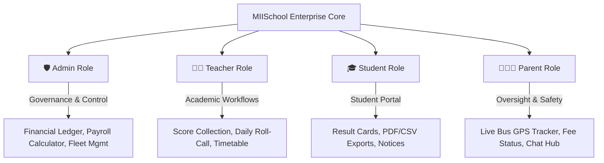

<div align="center">

# 🏫 Madrasaa Ifaa Islama (MIISchool)
### *Enterprise-Grade Madrasaa & School Management Mobile Ecosystem*

<p align="center">
  
</p>

[](https://developer.android.com)
[](https://kotlinlang.org)
[](https://developer.android.com/compose)
[](https://m3.material.io)
[](https://developer.android.com/training/data-storage/room)
[](https://opensource.org/licenses/MIT)

</div>

---

## 🌟 Project Overview & Vision

**Madrasaa Ifaa Islama (MIISchool)** is an enterprise-grade mobile school management platform engineered specifically for modern Madrasahs and educational institutions. Combining high-density administrative oversight (inspired by **Laravel Filament**) with smooth consumer-grade UX powered by **Jetpack Compose** and **Material 3 Expressive**, MIISchool bridges administrators, educators, students, and parents into a unified, lightning-fast digital ecosystem.

---

## 👥 The 4 Actor Roles Matrix

MIISchool features a robust Role-Based Access Control (RBAC) architecture supporting four distinct user personas. Below is a comprehensive feature comparison across actor roles:

<div align="center">

| Actor Role | Primary Focus | Core Capabilities & Permissions | Key Modules & Dashboards |
| :--- | :--- | :--- | :--- |
| 🛡️ **Administrator** | Institution Governance & Finance | • User provisioning & staff management<br>• Financial ledgers & fee collection<br>• Automated staff salary calculator<br>• Bus fleet & transport tracking | • Admin Dashboard<br>• Payroll & Expenses<br>• Fleet Management<br>• System Settings |
| 👩‍🏫 **Teacher** | Classroom & Academic Execution | • Continuous assessment & grading<br>• Daily attendance roll-call<br>• Homework & lesson planning<br>• Direct parent communication | • Teacher Dashboard<br>• Score Collection<br>• Attendance Logs<br>• Timetable |
| 🎓 **Student** | Academic Progress & Learning | • Personal grade tracking<br>• Result card PDF/CSV export<br>• Timetable & assignment viewing<br>• School noticeboard access | • Student Portal<br>• Interactive Result Cards<br>• Schedule View<br>• Directory |
| 👨‍👩‍👧 **Parent** | Child Monitoring & Safety | • Multi-child performance tracking<br>• Live school bus tracking & ETA<br>• Telegram-style teacher chat<br>• Fee receipts & payment history | • Parent Dashboard<br>• Bus GPS Simulator<br>• Chat Hub<br>• Fee Tracker |

</div>



---

<details>
<summary><b>🛠️ Tech Stack & Architecture (Click to expand)</b></summary>

### Architectural Highlights
- **Architecture Pattern**: MVVM (Model-View-ViewModel) with Unidirectional Data Flow (UDF) & StateFlow.
- **UI Framework**: Jetpack Compose, Material 3 Expressive, Material Icons Extended.
- **Navigation**: Jetpack Navigation 3 (`androidx.navigation3`) with type-safe `@Serializable` routing.
- **Local Persistence**: Room Database (`MadrasaaDatabase`) with Foreign Key relations, TypeConverters, and reactive Flow queries.
- **Reporting & Export**: Custom `PdfReportGenerator` (Canvas/PdfDocument) and `CsvExportHelper` streams.
- **Concurrency**: Kotlin Coroutines and Dispatchers.

</details>

<details>
<summary><b>🚀 Core Modules & Features (Click to expand)</b></summary>

### 1. Student Portal & Export Engine
- Dynamic term/semester grade summaries with GPA calculations.
- Instant export of official Result Cards to **PDF** and **CSV** for offline archiving.

### 2. Centralized Score Collection
- Streamlined grading grid for teachers.
- Automated score validation, locking, and archival in Room DB.

### 3. Financial Ledger & Salary Calculator
- Comprehensive income/expense tracking with visual summary metrics.
- Automated payroll computation factoring in base salaries, bonuses, deductions, and tax allowances.

### 4. Real-Time School Bus Tracker
- Interactive route simulation with live driver info, bus plate numbers, ETA countdown, and stop confirmation logs.

### 5. Telegram-Style Chat Hub
- Real-time messaging between parents, teachers, and admins with unread indicators and search filtering.

</details>

<details>
<summary><b>⚙️ Installation & Build Guide (Click to expand)</b></summary>

### Prerequisites
- **Android Studio**: Ladybug / Koala or newer.
- **Java Development Kit (JDK)**: JDK 17 or higher.
- **Android SDK**: API 24 (Nougat) to API 35 (Android 15).

### Step-by-Step Build Instructions

1. **Clone the Repository**:
   ```bash
   git clone https://github.com/your-org/madrasaa-ifaa-islama.git
   cd MarasaaApp
   ```

2. **Sync Gradle Dependencies**:
   Open the project in Android Studio and let Gradle sync, or run:
   ```bash
   ./gradlew --refresh-dependencies
   ```

3. **Assemble Debug APK**:
   ```bash
   ./gradlew assembleDebug
   ```

4. **Run Unit & Instrumentation Tests**:
   ```bash
   ./gradlew testDebugUnitTest
   ```

</details>

---

## 📁 Project Structure

```text
com.example.marasaaapp/
├── data/
│   ├── local/          # Room Database, DAOs, Entities, TypeConverters
│   ├── model/          # Domain data classes & role models
│   └── repository/     # Centralized SchoolRepository data source
├── ui/
│   ├── components/     # Reusable Filament tables, topbars, widgets
│   ├── dashboard/      # Role-specific dashboards (Admin, Teacher, Student, Parent)
│   ├── navigation/     # Navigation 3 scaffold & routing
│   ├── screens/        # Chat, Directory, Profile, Timetable screens
│   └── theme/          # M3 Dynamic Color schemes, typography, shapes
└── util/               # PDF generator & CSV export helpers
```

---

## 📄 License

This project is licensed under the MIT License - see the [LICENSE](LICENSE) file for details.
